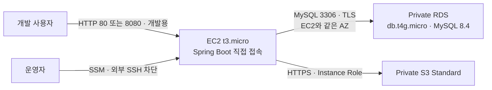

# KEEPIT 최소 사양 AWS 설계 · 검토안

이 코드는 **개발·실습용 EC2 1대 + RDS 1대 + S3 1개 + ECR 1개**를 관리합니다.
2026-11-19에 서울 리전 개발 환경에 Terraform 계획을 적용했습니다. 리소스 37개를 생성했으며 EC2의 SSM 연결, RDS 사용 가능 상태, 자동 백업 1일 보관을 확인했습니다.

## 검토할 구성

| 항목 | 개발 환경 설정 | 선택 이유 |
| --- | --- | --- |
| 계정 / 리전 | `781953768324` / 서울 `ap-northeast-2` | 로그인 프로필과 일치, 한국 사용자 접속 고려 |
| EC2 | `t3.micro`, 2 vCPU / RAM 1 GiB, Ubuntu 24.04 x86_64 | 현재 amd64 Docker 이미지와 호환되는 작은 개발용 구성. 안정적인 상시 구동은 `t3.small` 검토 |
| EC2 디스크 | 암호화 gp3 8 GiB, swap 1 GiB 포함 | 조회한 공식 AMI 루트 디스크의 최소 크기 |
| RDS | MySQL 8.4, `db.t4g.micro`, 2 vCPU / RAM 1 GiB, Single-AZ | 작은 MySQL 인스턴스, ARM 여부는 JDBC 클라이언트와 무관 |
| RDS 디스크 | 암호화 gp3 20 GiB, 자동 증설 끔 | 해당 엔진·클래스의 조회된 최소 용량 |
| S3 | Standard, 사용량 과금, 비공개, SSE-S3 | 파일 저장, 예약 용량 없음 |
| 네트워크 | VPC 1개, EC2 퍼블릭 서브넷 1개, RDS 격리 서브넷 2개 | RDS subnet group의 AZ 요구사항 충족; DB 2대를 만드는 것은 아님 |
| 서버 관리 | Session Manager, SSH 포트·키 없음 | 인바운드 관리 포트 불필요 |
| DB 관리자 비밀번호 | RDS 관리형 Secrets Manager | 비밀번호를 코드·user data·Terraform state에 넣지 않음 |
| 고정비 부가 서비스 | NAT Gateway·ALB·EIP·유료 VPC endpoint 미생성 | 개발 환경 고정비 최소화 |

`t3.micro`는 AWS 전체에서 절대 최저가인 EC2가 아니라, 현재 x86 이미지와 JVM 실행을 고려한 최소 시작점입니다.
nano급(512 MiB)은 Spring Boot·Docker·OS를 함께 실행하기에 부족할 수 있어 제외했습니다.
ARM 이미지를 별도 빌드·검증하면 `t4g.micro`를 비교할 수 있지만, 현재 설계의 AMI는 x86 전용입니다.
1 GiB도 부하·JVM 설정에 따라 OOM이 발생할 수 있으며, 초기 메모리 상한과 실측을 바탕으로 `t3.small`로 조정해야 합니다.
8 GiB 디스크에는 많은 이미지·빌드 캐시를 보관할 수 없습니다. 빌드는 GitHub Actions에서 수행하고 배포 시 오래된 이미지를 관리합니다.



`network.tf`에서 개발 EC2의 **80번과 8080번**을 전체 IPv4(`0.0.0.0/0`)에 허용합니다. Compose는 두 포트를 Spring Boot의 8080으로 연결합니다. 22번과 DB 외부 접속은 허용하지 않습니다.
비공개 실습이면 두 HTTP 인바운드 규칙을 제외하고, 본인만 접속하려면 두 규칙의 접근 범위를 본인 공인 IPv4의 `/32` 대역으로 수정합니다.
아직 도메인·인증서를 정하지 않아 443은 열지 않습니다. 실제 사용자 로그인·개인정보를 처리하기 전 HTTPS 구성이 별도로 필요합니다.

## 비용과 변경 계획

- [항목별 예상 비용](review/cost-estimate.md): 월 730시간, S3 1GB 가정 **$35.16/월**, 세금·크레딧 차감 전
- [기존 인프라 plan 검토 결과](review/plan-summary.md): ECR·배포 권한 추가 전 **31개 생성, 변경 0개, 삭제 0개**
- [공개 단가 원본](review/pricing-seoul.json): AWS Price List API의 서울 리전 응답

ECR 이미지 저장량·요청과 배포 관련 사용량은 위 기존 인프라 예상 비용에 포함되지 않았습니다.
크레딧의 실제 잔액·만료·적용 조건은 확인하지 않았으므로 무료라고 보장하지 않습니다.
전송·요청·RDS CPU credit·초과 백업 등 사용량 비용은 예상 기본 합계 밖에서 발생할 수 있습니다.
RDS T 계열의 CPU credit 추가 요금과 달리, EC2는 `standard` 모드로 추가 CPU credit 과금 대신 성능 제한을 선택했습니다.
AWS Budgets와 Free Tier 알림 설정을 권장합니다. 알림은 비용 상한이나 자동 종료 기능이 아닙니다.

## 코드 구성

```text
infra/
  environments/dev/
    versions.tf              # Terraform/AWS Provider 및 초기 local backend
    providers.tf             # 계정·리전, 공식 Ubuntu AMI, 공통 태그
    network.tf               # 웹 접근 범위, VPC, 서브넷, 라우팅, Security Group
    compute.tf               # EC2 사양, Instance Profile, S3 권한, SSM
    database.tf              # MySQL 버전, RDS, TLS, 백업과 삭제 방지
    storage.tf               # S3 접근 차단·암호화·버전 보관
    outputs.tf               # IP, DB endpoint, secret ARN 등 비밀값 없는 출력
    templates/bootstrap.sh   # Docker/Compose·SSM·swap·로그 제한
    .terraform.lock.hcl      # 검증한 Provider 버전과 체크섬; Git에 포함
  scripts/
    review_plan.py           # 저장된 plan의 보안·비용 경계 검사
    estimate_cost.py         # 공개 단가 스냅샷에서 비용 재계산
  review/                    # 사용자 검토 문서
```

## 로컬에서 검토하기

AWS CLI와 Terraform을 설치한 뒤 새 PowerShell에서 `infra/environments/dev`로 이동합니다. `aws sts get-caller-identity --profile keepit-dev`로 계정이 `781953768324`인지 확인합니다. 세션이 만료됐다면 `aws login --profile keepit-dev`로 인증을 갱신합니다.

같은 PowerShell에서 로그인 세션의 임시 자격 증명을 환경변수로 설정합니다. Terraform이 이 터미널에서 실행될 때 세 환경변수를 물려받습니다.

```powershell
$keepitCredentials = aws configure export-credentials --profile keepit-dev --format process | ConvertFrom-Json
if ($LASTEXITCODE -ne 0 -or -not $keepitCredentials.SessionToken) {
    throw 'keepit-dev 임시 자격 증명을 가져오지 못했습니다.'
}

$env:AWS_ACCESS_KEY_ID = $keepitCredentials.AccessKeyId
$env:AWS_SECRET_ACCESS_KEY = $keepitCredentials.SecretAccessKey
$env:AWS_SESSION_TOKEN = $keepitCredentials.SessionToken
Remove-Variable keepitCredentials
```

같은 터미널에서 처음 실행할 때는 `terraform init -lockfile=readonly`로 초기화합니다. 아래 명령으로 계획을 생성하고 확인합니다.

```powershell
terraform plan -out=review.tfplan
terraform show -no-color review.tfplan
```

생성 전용·네트워크·암호화·비용 경계를 검토하려면 아래 명령을 실행합니다.

```powershell
terraform show -json review.tfplan | python ../../scripts/review_plan.py
python ../../scripts/estimate_cost.py
```

개발 환경 값은 해당 `.tf` 파일에서 변경합니다. 계정·리전은 `providers.tf`, EC2 사양은 `compute.tf`, 80·8080 접근 대역은 `network.tf`, MySQL 버전은 `database.tf`에서 지정합니다.

`review_plan.py`는 서울·t3.micro 예시 구성을 검사하는 검토 도구입니다.
리전·사양·인바운드 정책 변경 시 코드와 요금, 검증 조건 및 검토 문서를 함께 갱신해야 합니다.
`.terraform/`, `*.tfstate*`, `*.tfplan`, 실제 `*.tfvars`는 Git에서 제외합니다.
계정 ID는 비밀키가 아니며 Provider의 `allowed_account_ids`가 다른 계정으로의 실수 적용을 차단합니다.
임시 자격 증명은 현재 PowerShell과 그 하위 프로세스에서 사용합니다. 작업을 마치면 PowerShell을 닫습니다.

## 승인 후 진행 순서

1. 리전·비용·사양·공개 HTTP 접근·백업 보관 정책을 검토받습니다.
2. 최신 데이터로 plan을 다시 만들고 리소스 생성 권한·Free Tier 제한·크레딧 잔액·리전 할당량을 확인합니다.
3. 검토한 저장 계획을 수동으로 적용합니다.
4. EC2의 `/opt/keepit/bootstrap-complete`와 `/var/log/cloud-init-output.log`, SSM Online 상태를 확인합니다.
5. 앱 이미지 빌드·RDS 애플리케이션 계정·운영 비밀값·HTTPS·S3 접근 방식을 연결하는 배포 작업을 별도로 검토합니다.

plan 성공은 EC2/RDS 생성 API의 모든 IAM 권한·실제 부팅·패키지 설치 성공을 보장하지 않습니다.
실행 계정에는 필요한 EC2·RDS·S3·IAM 작업 및 `iam:PassRole` 등의 권한이 있어야 하며,
최초 RDS 생성 시 서비스 연결 역할 생성 권한이 필요할 수 있습니다. 이 검토 작업은 사용자 IAM 권한을 변경하지 않았습니다.

## 애플리케이션 연결 시 필요한 작업

PR이 `develop`에 병합되어 push 이벤트가 발생하면 `.github/workflows/cd.yml`이 빌드·테스트 후 ECR에 커밋 SHA 이미지로 push하고 SSM으로 개발 EC2에서 `docker-compose.dev.yml`을 실행합니다. 수동 실행에서도 배포 작업은 `develop`에서만 실행되며, AWS 배포 역할도 해당 브랜치의 OIDC 토큰만 허용합니다. `docker-compose.yml`은 로컬 PC의 MySQL·선택적 Redis 용도입니다. `docker-compose.prod.yml`은 Nginx를 포함한 향후 운영용 파일이며 현재 자동 배포 대상이 아닙니다.

| 환경 | Compose | Spring 프로필 | DB | 외부 포트 | 현재 배포 트리거 |
| --- | --- | --- | --- | --- | --- |
| 로컬 PC | `docker-compose.yml` | `local` (IDE/bootRun) | 로컬 MySQL 컨테이너 | 앱 8080은 IDE에서 실행 | 개발자가 직접 실행 |
| 개발 EC2 | `docker-compose.dev.yml` | `dev` | 비공개 RDS, EC2의 `/opt/keepit/.env` | 호스트 80·8080 → 앱 8080 | `develop` push 또는 `develop`에서 수동 실행 |
| 향후 운영 | `docker-compose.prod.yml` | `prod` | 운영 전용 DB·비밀값 필요 | Nginx 80 | 아직 없음 |

운영 배포는 개발 배포의 설정을 바꾸는 방식이 아니라 별도 인프라·환경변수·권한·워크플로를 마련해야 합니다. 운영 배포 트리거는 현재 정의되지 않았습니다. 예를 들어 릴리스 태그를 만들 때 운영 전용 GitHub Actions 작업을 실행하도록 나중에 설정할 수 있습니다.
최초 Terraform apply 이후 EC2의 `/opt/keepit/.env`와 RDS 애플리케이션 계정을 준비해야 첫 배포가 성공합니다. `.env`는 GitHub Actions에서 덮어쓰지 않습니다.

환경변수는 첫 배포 전에 AWS 콘솔의 **Systems Manager → Session Manager**로 EC2에 접속해 `/opt/keepit/.env`에 입력합니다. `DB_URL`에는 Terraform의 `jdbc_url` 출력을 사용하고, `DB_USERNAME`과 `DB_PASSWORD`에는 별도 생성한 애플리케이션 계정의 값을 넣습니다. `JWT_SECRET`은 `openssl rand -hex 32` 등으로 생성한 키를 넣습니다. S3에 필요한 `AWS_REGION`과 `AWS_S3_BUCKET`은 Terraform의 `deployment_region`과 `s3_bucket_name` 출력입니다. S3는 EC2 IAM 역할로 인증합니다. 카카오 로그인을 테스트하려면 `KAKAO_CLIENT_ID`, `KAKAO_REDIRECT_URI` 및 카카오 앱에서 사용 설정한 경우 `KAKAO_CLIENT_SECRET`을 입력합니다. 파일은 root 소유·권한 `0600`으로 보관합니다. 실제 비밀값을 Git이나 GitHub Actions 로그에 입력하지 않습니다. 이후 자동 배포는 이 파일을 읽습니다. 비밀값 변경 시에는 EC2의 파일을 갱신하고 컨테이너를 다시 생성해 환경변수를 반영합니다.

Session Manager 터미널에서 `sudo install -m 600 -o root -g root /dev/null /opt/keepit/.env`로 파일을 만들고 `sudo vi /opt/keepit/.env`로 값을 입력합니다. DB 이름과 비밀번호는 RDS 관리자 계정 대신 별도 앱 계정의 값을 사용합니다. `KAKAO_REDIRECT_URI`는 실제 접속 주소와 8080 포트에 맞춰 등록해야 합니다. EC2가 교체되면 이 로컬 파일도 다시 준비해야 합니다.

현재 EC2 사양인 `t3.micro`는 1 GiB RAM이라 JVM·Docker·OS를 함께 실행하면 메모리 부족과 swap 지연이 생길 수 있습니다. 루트 디스크 8 GiB도 이미지 누적에 여유가 작습니다. 지속 구동 전에는 메모리와 디스크 사용량을 확인하고, 필요하면 `instance_type = "t3.small"` 및 디스크 용량 확대를 계획해야 합니다.

- EC2의 `/opt/keepit/.env`에 운영 비밀값을 준비. Compose 파일은 배포 워크플로가 SSM으로 전달
- RDS 관리자 secret은 운영자가 확인하고 애플리케이션용 DB 사용자를 별도로 생성. 앱에 관리자 계정을 사용하지 않음
- 앱 DB 비밀번호·JWT·카카오 비밀값은 SSM Parameter Store SecureString 등으로 별도 관리. 값은 Terraform으로 읽어들이지 않음
- EC2 Role은 해당 S3 버킷 접근, ECR 이미지 pull, SSM 기본 권한을 보유. RDS 관리자 secret 읽기 권한은 부여하지 않음
- SecureString을 서버에서 가져오려면 해당 경로로 제한한 GetParameter/KMS 권한과 런타임 주입 절차를 별도 추가
- RDS TLS `require_secure_transport=1` 강제. 개발용 `jdbc_url`은 `sslMode=REQUIRED`로 암호화하며, 실서비스 전에 JVM trust store에 RDS CA를 설치하고 `VERIFY_IDENTITY`로 인증서와 호스트를 검증
- 개발 프로필의 S3 서비스는 비공개 파일에 10분 유효한 서명 다운로드 URL을 생성합니다.
- 파일 CORS는 프런트엔드 도메인이 결정된 후 필요한 origin·method만 허용
- 초기 JVM heap은 작게 시작해 메모리 실측. 예: `JAVA_TOOL_OPTIONS=-Xms128m -Xmx384m`, Compose의 메모리 제한 및 로그 회전 검토
- SSM 브라우저 콘솔로 서버 관리 가능. 로컬 `aws ssm start-session` 사용 시 Session Manager plugin도 별도 필요
- S3 서버 접근 로그·CloudTrail data events·요청 메트릭, SSM 세션 로그를 운영 전 검토 권장. 추가 저장·이벤트·메트릭 요금이 있어 최소 구성에는 미생성

## 데이터 보관·정리와 state

- RDS는 매일 한국시간 오전 3:00~3:30에 자동 백업을 시작하고 1일간 보관합니다. 데이터베이스는 Single-AZ로 배치합니다.
- S3 버전 관리 활성화. 이전 버전은 7일 후 만료, 미완료 multipart 업로드는 1일 후 정리합니다. 현재 버전은 자동 만료하지 않습니다.
- RDS와 S3는 `prevent_destroy`, RDS는 AWS 삭제 방지도 켜져 있어 일반적인 destroy가 중단됩니다.
- 정리할 때 별도 승인을 받고 백업을 확보한 후 이 보호 장치를 의도적으로 해제해야 합니다. `force_destroy`는 켜지 않습니다.
- RDS 최종 스냅샷 이름 `keepit-dev-final`이 이미 존재하면 새 이름을 지정해야 합니다. 스냅샷·보존 백업은 삭제 후에도 과금될 수 있습니다.
- EC2 자동 public IPv4는 중지·시작 후 바뀔 수 있습니다. EIP를 만들지 않았으므로 DNS 고정 운영은 다음 설계에서 결정합니다.
- EC2 root disk는 종료 시 삭제됩니다. DB·사용자 파일은 RDS·S3에 보관하고 `.env`와 이미지의 복구 절차를 별도로 준비합니다.
- 현재는 단독 검토용 local state입니다. 첫 apply 후 state를 잃으면 리소스 연결을 잃으므로 Git 외부의 암호화된 저장소에 백업해야 합니다.
- **팀이 apply하기 전에는 S3 backend(버전 관리·암호화·퍼블릭 차단·`use_lockfile=true`)로 이전해야 합니다.**
  state 전용 버킷은 애플리케이션 파일 버킷과 분리하고 선행 생성한 뒤 backend 변경과 `terraform init -migrate-state`를 진행합니다.
  이번 최소안에는 state 전용 버킷과 그 bootstrap apply를 포함하지 않았습니다.
- 환경을 분리하려면 dev 디렉터리를 다른 계정/환경 전용 root module과 state로 분리하고 이름·태그·CIDR을 함께 변경합니다.

## 공식 참고

- [Terraform AWS Provider](https://registry.terraform.io/providers/hashicorp/aws/latest/docs)
- [RDS MySQL](https://docs.aws.amazon.com/AmazonRDS/latest/UserGuide/CHAP_MySQL.html)
- [RDS gp3 최소 용량](https://docs.aws.amazon.com/AmazonRDS/latest/UserGuide/CHAP_Storage.html)
- [S3 보안 권장 사항](https://docs.aws.amazon.com/AmazonS3/latest/userguide/security-best-practices.html)
- [Ubuntu SSM Agent](https://docs.aws.amazon.com/systems-manager/latest/userguide/agent-install-ubuntu.html)
- [Terraform S3 state backend](https://developer.hashicorp.com/terraform/language/backend/s3)
