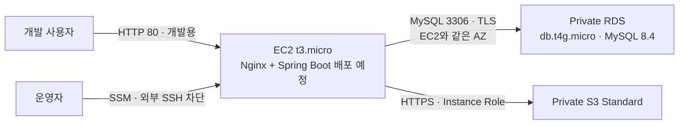

# KEEPIT 최소 사양 AWS 설계 · 검토안

이 코드는 **개발·실습용 EC2 1대 + RDS 1대 + S3 1개**의 생성 계획입니다.
2026-11-17에 코드 작성·공식 Provider 설치·유효성 검사·읽기 전용 plan을 수행했습니다.
**사용자 승인 전 `terraform apply`는 실행하지 않았으며, 이 작업으로 AWS 리소스를 생성하지 않았습니다.**

## 검토할 구성

| 항목 | 기본 설계 | 선택 이유 |
| --- | --- | --- |
| 계정 / 리전 | `781953768324` / 서울 `ap-northeast-2` | 로그인 프로필과 일치, 한국 사용자 접속 고려 |
| EC2 | `t3.micro`, 2 vCPU / RAM 1 GiB, Ubuntu 24.04 x86_64 | 현재 amd64 Docker 이미지와 호환되는 작은 개발용 구성 |
| EC2 디스크 | 암호화 gp3 8 GiB, swap 1 GiB 포함 | 조회한 공식 AMI 루트 디스크의 최소 크기 |
| RDS | MySQL 8.4, `db.t4g.micro`, 2 vCPU / RAM 1 GiB, Single-AZ | 작은 MySQL 인스턴스, ARM 여부는 JDBC 클라이언트와 무관 |
| RDS 디스크 | 암호화 gp3 20 GiB, 자동 증설 끔 | 해당 엔진·클래스의 조회된 최소 용량 |
| S3 | Standard, 사용량 과금, 비공개, SSE-S3 | 파일 저장, 예약 용량 없음 |
| 네트워크 | VPC 1개, EC2 퍼블릭 서브넷 1개, RDS 격리 서브넷 2개 | RDS subnet group의 AZ 요구사항 충족; DB 2대를 만드는 것은 아님 |
| 서버 관리 | Session Manager, SSH 포트·키 없음 | 인바운드 관리 포트 불필요 |
| DB 관리자 비밀번호 | RDS 관리형 Secrets Manager | 비밀번호를 코드·user data·Terraform state에 넣지 않음 |
| 고정비 부가 서비스 | NAT Gateway·ALB·EIP·유료 VPC endpoint 미생성 | 개발 환경 고정비 최소화 |

`t3.micro`는 AWS 전체에서 절대 최저가인 EC2가 아니라, 현재 x86 이미지와 JVM 실행을 고려한 최소 시작점입니다.
nano급(512 MiB)은 Spring Boot·Nginx·OS를 함께 실행하기에 부족할 수 있어 제외했습니다.
ARM 이미지를 별도 빌드·검증하면 `t4g.micro`를 비교할 수 있지만, 현재 설계의 AMI는 x86 전용입니다.
1 GiB도 부하·JVM 설정에 따라 OOM이 발생할 수 있으며, 초기 메모리 상한과 실측을 바탕으로 `t3.small`로 조정해야 합니다.
8 GiB 디스크에는 많은 이미지·빌드 캐시를 보관할 수 없습니다. 빌드는 GitHub Actions에서 수행하고 배포 시 오래된 이미지를 관리합니다.



기본 웹 인바운드는 `0.0.0.0/0`의 **80번**만 허용합니다. 22·8080·DB 외부 접속은 허용하지 않습니다.
비공개 실습이면 `web_ingress_cidrs = []`, 본인만 접속하려면 본인 공인 IPv4 `/32`로 제한합니다.
아직 도메인·인증서를 정하지 않아 443은 열지 않습니다. 실제 사용자 로그인·개인정보를 처리하기 전 HTTPS 구성이 별도로 필요합니다.

## 비용과 변경 계획

- [항목별 예상 비용](review/cost-estimate.md): 월 730시간, S3 1GB 가정 **$35.16/월**, 세금·크레딧 차감 전
- [실제 plan 검토 결과](review/plan-summary.md): **31개 생성, 변경 0개, 삭제 0개**
- [공개 단가 원본](review/pricing-seoul.json): AWS Price List API의 서울 리전 응답

EC2·RDS·S3 세 서비스 외에도 네트워크·Security Group·IAM 등의 구성 객체가 포함되어 31개입니다.
크레딧의 실제 잔액·만료·적용 조건은 확인하지 않았으므로 무료라고 보장하지 않습니다.
전송·요청·RDS CPU credit·초과 백업 등 사용량 비용은 예상 기본 합계 밖에서 발생할 수 있습니다.
RDS T 계열의 CPU credit 추가 요금과 달리, EC2는 `standard` 모드로 추가 CPU credit 과금 대신 성능 제한을 선택했습니다.
AWS Budgets와 Free Tier 알림 설정을 권장합니다. 알림은 비용 상한이나 자동 종료 기능이 아닙니다.

## 코드 구성

```text
infra/
  environments/dev/
    versions.tf              # Terraform/AWS Provider 및 초기 local backend
    providers.tf             # 계정 보호, 리전, 공식 Ubuntu AMI, 공통 태그
    variables.tf             # 리전·사양·웹 접근 범위
    network.tf               # VPC, 서브넷, 라우팅, Security Group
    compute.tf               # EC2, Instance Profile, S3 권한, SSM
    database.tf              # RDS, TLS, 백업과 삭제 방지
    storage.tf               # S3 접근 차단·암호화·버전 보관
    outputs.tf               # IP, DB endpoint, secret ARN 등 비밀값 없는 출력
    templates/bootstrap.sh   # Docker/Compose·SSM·swap·로그 제한
    terraform.tfvars.example
    .terraform.lock.hcl      # 검증한 Provider 버전과 체크섬; Git에 포함
  scripts/
    Review-Plan.ps1          # 임시 자격 증명으로 init/fmt/validate/plan만 실행
    review_plan.py           # 저장된 plan의 보안·비용 경계 검사
    estimate_cost.py         # 공개 단가 스냅샷에서 비용 재계산
  review/                    # 사용자 검토 문서
```

## 로컬에서 검토하기

AWS CLI·Terraform 설치 후 새 PowerShell을 사용합니다. 계정 인증은 `keepit-dev` 프로필을 사용합니다.
작업 디렉터리는 저장소 루트입니다.

```powershell
# 필요할 때만 브라우저에서 로그인 갱신
aws login --profile keepit-dev
aws sts get-caller-identity --profile keepit-dev

# 선택: 기본값을 바꾸려면 예제 복사 후 편집
Copy-Item infra/environments/dev/terraform.tfvars.example infra/environments/dev/terraform.tfvars

# 검토 스크립트에는 apply 명령이 없습니다.
./infra/scripts/Review-Plan.ps1

# 저장된 변경 계획에서 생성 전용·네트워크·암호화·비용 경계 검사
terraform '-chdir=infra/environments/dev' show -json review.tfplan | python infra/scripts/review_plan.py
python infra/scripts/estimate_cost.py
```

`review_plan.py`는 현재 서울·t3.micro 기본안을 검사하는 검토 도구입니다.
리전·사양·인바운드 정책 변경 시 코드와 요금, 검증 조건 및 검토 문서를 함께 갱신해야 합니다.
`.terraform/`, `*.tfstate*`, `*.tfplan`, 실제 `*.tfvars`는 Git에서 제외합니다.
계정 ID는 비밀키가 아니며 Provider의 `allowed_account_ids`가 다른 계정으로의 실수 적용을 차단합니다.
임시 자격 증명은 스크립트 프로세스 메모리에만 전달하고 종료 시 원래 환경변수를 복원합니다.

## 승인 후 진행 순서

1. 리전·비용·사양·공개 HTTP 접근·백업 보관 정책을 검토받습니다.
2. 최신 데이터로 plan을 다시 만들고 리소스 생성 권한·Free Tier 제한·크레딧 잔액·리전 할당량을 확인합니다.
3. 승인된 계획만 수동 apply합니다. 현재 문서 작성 작업에서는 실행하지 않았습니다.
4. EC2의 `/opt/keepit/bootstrap-complete`와 `/var/log/cloud-init-output.log`, SSM Online 상태를 확인합니다.
5. 앱 이미지 빌드·RDS 애플리케이션 계정·운영 비밀값·HTTPS·S3 접근 방식을 연결하는 배포 작업을 별도로 검토합니다.

plan 성공은 EC2/RDS 생성 API의 모든 IAM 권한·실제 부팅·패키지 설치 성공을 보장하지 않습니다.
실행 계정에는 필요한 EC2·RDS·S3·IAM 작업 및 `iam:PassRole` 등의 권한이 있어야 하며,
최초 RDS 생성 시 서비스 연결 역할 생성 권한이 필요할 수 있습니다. 이 검토 작업은 사용자 IAM 권한을 변경하지 않았습니다.

## 애플리케이션 연결 시 필요한 작업

현재 코드는 **인프라 및 Docker 호스트 준비까지**입니다. 기존 Java 코드·운영 Compose·CI/CD는 변경하지 않았습니다.
인프라 생성만으로 KEEPIT API가 배포되지는 않습니다.

- `application-prod.yml` datasource 및 필요한 S3 SDK·설정·서비스의 `[AWS 보류]` 항목 활성화
- Docker Hub 이미지·운영 Compose·Nginx 파일을 `/opt/keepit`에 배치하고 실행
- RDS 관리자 secret은 운영자가 확인하고 애플리케이션용 DB 사용자를 별도로 생성. 앱에 관리자 계정을 사용하지 않음
- 앱 DB 비밀번호·JWT·카카오 비밀값은 SSM Parameter Store SecureString 등으로 별도 관리. 값은 Terraform으로 읽어들이지 않음
- EC2 Role은 해당 S3 버킷의 GetObject·PutObject·DeleteObject와 SSM 기본 권한만 보유. RDS 관리자 secret 읽기 권한은 부여하지 않음
- SecureString을 서버에서 가져오려면 해당 경로로 제한한 GetParameter/KMS 권한과 런타임 주입 절차를 별도 추가
- RDS TLS `require_secure_transport=1` 강제. JVM trust store에 RDS CA를 설치하고 JDBC `sslMode=VERIFY_IDENTITY`로 인증서와 호스트 검증
- 비공개 S3 파일은 presigned URL 또는 인증된 백엔드로 제공. 단순 공개 object URL 반환은 403이 됨
- 파일 CORS는 프런트엔드 도메인이 결정된 후 필요한 origin·method만 허용
- 초기 JVM heap은 작게 시작해 메모리 실측. 예: `JAVA_TOOL_OPTIONS=-Xms128m -Xmx384m`, Compose의 메모리 제한 및 로그 회전 검토
- SSM 브라우저 콘솔로 서버 관리 가능. 로컬 `aws ssm start-session` 사용 시 Session Manager plugin도 별도 필요
- S3 서버 접근 로그·CloudTrail data events·요청 메트릭, SSM 세션 로그를 운영 전 검토 권장. 추가 저장·이벤트·메트릭 요금이 있어 최소 구성에는 미생성

## 데이터 보관·정리와 state

- RDS 자동 백업 보관 1일, Single-AZ. 자동 장애 전환·장기간 복구가 필요한 운영 구성은 아닙니다.
- S3 버전 관리 활성화. 이전 버전은 7일 후 만료, 미완료 multipart 업로드는 1일 후 정리합니다. 현재 버전은 자동 만료하지 않습니다.
- RDS와 S3는 `prevent_destroy`, RDS는 AWS 삭제 방지도 켜져 있어 일반적인 destroy가 중단됩니다.
- 정리할 때 별도 승인을 받고 백업을 확보한 후 이 보호 장치를 의도적으로 해제해야 합니다. `force_destroy`는 켜지 않습니다.
- RDS 최종 스냅샷 이름 `keepit-dev-final`이 이미 존재하면 새 이름을 지정해야 합니다. 스냅샷·보존 백업은 삭제 후에도 과금될 수 있습니다.
- EC2 자동 public IPv4는 중지·시작 후 바뀔 수 있습니다. EIP를 만들지 않았으므로 DNS 고정 운영은 다음 설계에서 결정합니다.
- EC2 root disk는 종료 시 삭제됩니다. DB·사용자 파일은 RDS·S3에 보관하고 `.env`와 이미지의 복구 절차를 별도로 준비합니다.
- 현재는 단독 검토용 local state입니다. 첫 apply 후 state를 잃으면 리소스 연결을 잃으므로 Git 외부의 암호화된 저장소에 백업해야 합니다.
- **팀이 apply하기 전에는 S3 backend(버전 관리·암호화·퍼블릭 차단·`use_lockfile=true`)로 이전해야 합니다.**
  state 전용 버킷은 애플리케이션 파일 버킷과 분리하고 선행 생성한 뒤 backend 변경과 `terraform init -migrate-state`를 진행합니다.
  이번 최소안에는 state 전용 버킷과 그 bootstrap apply를 포함하지 않았습니다.
- 환경을 분리하려면 dev 디렉터리를 다른 계정/환경 전용 root module과 state로 분리하고 이름·태그·CIDR을 함께 변경합니다.

## 공식 참고

- [Terraform AWS Provider](https://registry.terraform.io/providers/hashicorp/aws/latest/docs)
- [RDS MySQL](https://docs.aws.amazon.com/AmazonRDS/latest/UserGuide/CHAP_MySQL.html)
- [RDS gp3 최소 용량](https://docs.aws.amazon.com/AmazonRDS/latest/UserGuide/CHAP_Storage.html)
- [S3 보안 권장 사항](https://docs.aws.amazon.com/AmazonS3/latest/userguide/security-best-practices.html)
- [Ubuntu SSM Agent](https://docs.aws.amazon.com/systems-manager/latest/userguide/agent-install-ubuntu.html)
- [Terraform S3 state backend](https://developer.hashicorp.com/terraform/language/backend/s3)
